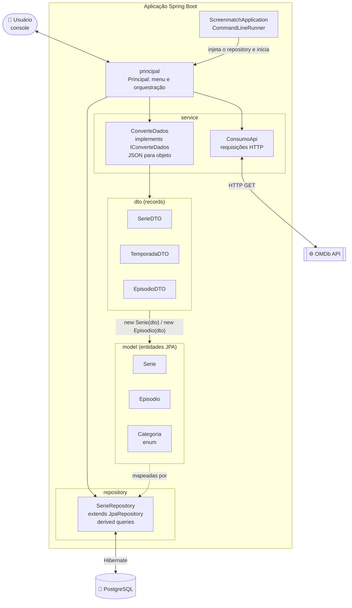
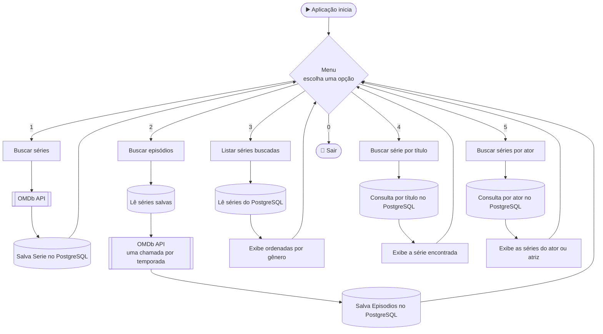
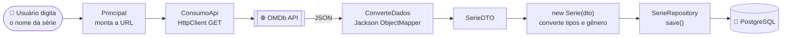
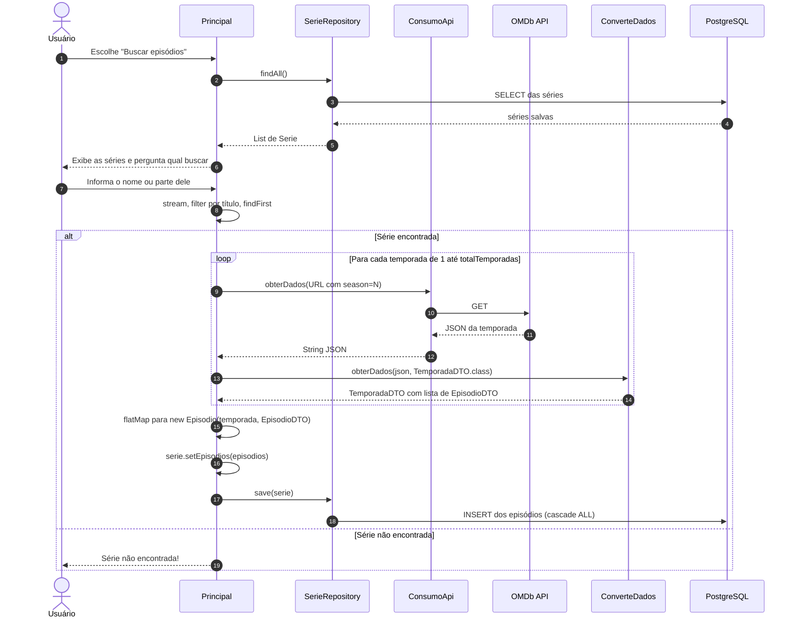
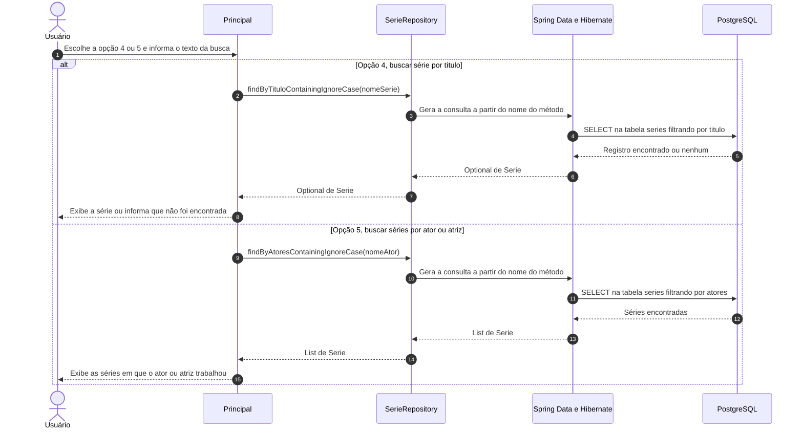
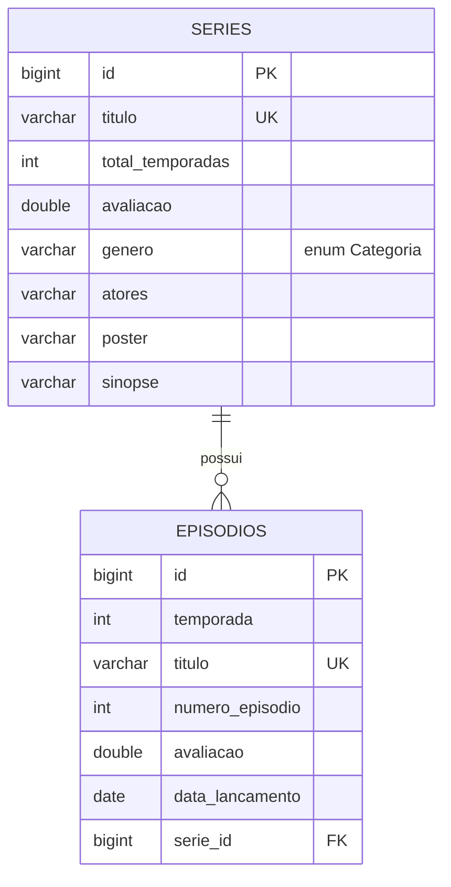

<div align="center">

# 🎬 ScreenMatch

**Aplicação Java com Spring Boot que consome a API OMDb, busca séries e episódios e persiste tudo em PostgreSQL para consultas futuras.**


</div>

---

## 📑 Sumário

- [Sobre o projeto](#-sobre-o-projeto)
- [Funcionalidades](#-funcionalidades)
- [Tecnologias e conceitos](#-tecnologias-e-conceitos)
- [Arquitetura em camadas](#-arquitetura-em-camadas)
- [Fluxo dos dados](#-fluxo-dos-dados)
- [Modelo de dados](#-modelo-de-dados)
- [Estrutura de pastas](#-estrutura-de-pastas)
- [Destaques técnicos](#-destaques-técnicos)
- [Como executar](#-como-executar)
- [Exemplo de uso](#-exemplo-de-uso)
- [Aprendizados](#-aprendizados)
- [Próximos passos](#-próximos-passos)
- [Autor](#-autor)

---

## 📖 Sobre o projeto

O **ScreenMatch** é um projeto prático da formação **Java Back End da [Alura](https://www.alura.com.br/)**. A aplicação funciona como um catálogo pessoal de séries, operado pelo console: o usuário informa o nome de uma série, o sistema consulta a **[OMDb API](https://www.omdbapi.com/)** via HTTP, converte o JSON recebido em objetos Java e **salva os dados no PostgreSQL**. Depois disso, as séries e os episódios ficam disponíveis para consulta local, sem precisar chamar a API novamente.

Neste projeto, pratiquei em conjunto:

- consumo de API externa e tratamento da resposta JSON;
- mapeamento objeto-relacional com **JPA/Hibernate**, incluindo relacionamento 1:N com persistência em cascata;
- persistência com **Spring Data JPA**, incluindo consultas por **Derived Queries**;
- organização do código em **camadas** (`model`, `repository`, `service`, `dto`);
- injeção de dependência com **Spring Boot**;
- gerenciamento de dependências e build com **Maven**.

---

## ✨ Funcionalidades

O menu interativo no console oferece cinco operações:

| Opção | Funcionalidade              | O que acontece                                                                                                                                                                                                                   |
|:-----:|-----------------------------|----------------------------------------------------------------------------------------------------------------------------------------------------------------------------------------------------------------------------------|
| **1** | **Buscar séries**           | Pergunta o nome da série, consulta a OMDb API, converte a resposta em uma entidade `Serie` e a salva no banco                                                                                                                    |
| **2** | **Buscar episódios**        | Lista as séries salvas, pergunta de qual buscar os episódios (aceita parte do nome, sem diferenciar maiúsculas de minúsculas), busca **todas as temporadas** na API, converte em entidades `Episodio` e salva vinculados à série |
| **3** | **Listar séries buscadas**  | Lê todas as séries do banco e as exibe **ordenadas por gênero**                                                                                                                                                                  |
| **4** | **Buscar série por título** | Pesquisa no banco por parte do título, sem diferenciar maiúsculas de minúsculas, usando a *derived query* `findByTituloContainingIgnoreCase`                                                                                     |
| **5** | **Buscar séries por ator**  | Recebe o nome (ou parte do nome) de um ator ou atriz e retorna, direto do banco, todas as séries salvas em que ele ou ela trabalhou, usando a *derived query* `findByAtoresContainingIgnoreCase`                                 |
| **0** | **Sair**                    | Encerra a aplicação                                                                                                                                                                                                              |

> 💡 A API só é chamada nas opções 1 e 2. As opções 3, 4 e 5 consultam exclusivamente o banco de dados, por isso só
> encontram séries que já foram buscadas pela opção 1.

---

## 🛠 Tecnologias e conceitos

| Categoria                | Tecnologia / Conceito                                              |
|--------------------------|--------------------------------------------------------------------|
| **Linguagem**            | Java 17+ (`record`, text blocks, Streams, `Optional`)              |
| **Framework**            | Spring Framework e Spring Boot (`CommandLineRunner`, `@Autowired`) |
| **Persistência**         | Spring Data JPA (`JpaRepository` e Derived Queries), Hibernate     |
| **Banco de dados**       | PostgreSQL e SQL                                                   |
| **Build e dependências** | Maven (com Maven Wrapper)                                          |
| **Integração externa**   | OMDb API consumida com `java.net.http.HttpClient`                  |
| **Serialização JSON**    | Jackson (`ObjectMapper`, `@JsonAlias`, `@JsonIgnoreProperties`)    |
| **Padrões**              | Arquitetura em camadas, DTO, Repository, Injeção de Dependência    |

---

## 🏗 Arquitetura em camadas

O código é dividido em camadas com responsabilidades bem definidas.



### Responsabilidade de cada camada

| Pacote           | Classes                                         | Responsabilidade                                                                                                                    |
|------------------|-------------------------------------------------|-------------------------------------------------------------------------------------------------------------------------------------|
| **`principal`**  | `Principal`                                     | Interação com o usuário (menu no console) e orquestração do fluxo entre API, conversão e banco                                      |
| **`service`**    | `ConsumoApi`, `ConverteDados`, `IConverteDados` | Faz a requisição HTTP e converte o JSON em objetos (a conversão é genérica e reutilizável)                                          |
| **`dto`**        | `SerieDTO`, `TemporadaDTO`, `EpisodioDTO`       | *Records* imutáveis que espelham exatamente o formato da resposta da OMDb API                                                       |
| **`model`**      | `Serie`, `Episodio`, `Categoria`                | Entidades JPA que representam as tabelas, mais o enum de gêneros do domínio                                                         |
| **`repository`** | `SerieRepository`                               | Acesso ao banco via Spring Data JPA: métodos prontos do `JpaRepository` e consultas derivadas do nome do método (*derived queries*) |

> **Por que separar DTO e Model?** O DTO espelha o contrato da API externa (nomes em inglês, números como `String`, datas como texto). A entidade representa o que o *meu* sistema armazena, já com tipos corretos (`Double`, `LocalDate`, `Categoria`). A conversão acontece nos construtores das entidades, isolando o domínio de mudanças na API.

---

## 🔄 Fluxo dos dados

### Visão geral do menu



### Opção 1: buscar uma série



### Opção 2: buscar episódios (sequência detalhada)



### Opção 3: listar séries

`SerieRepository.findAll()` → `PostgreSQL` → lista ordenada com `Comparator.comparing(Serie::getGenero)` → impressão no console.

### Opções 4 e 5: consultas por título e por ator (Derived Queries)

Nessas opções **não há chamada à API**: a consulta é feita direto no PostgreSQL. O Spring Data JPA gera a query a partir
do nome do método declarado no `SerieRepository`.



---

## 🗄 Modelo de dados

Relacionamento **1:N** entre `Serie` e `Episodio`: uma série possui vários episódios, e cada episódio pertence a uma série.



### Categorias (enum `Categoria`)

O gênero retornado pela OMDb vem em inglês e pode conter vários valores (ex.: `"Comedy, Drama"`). O sistema usa o **primeiro gênero** e o traduz para uma categoria própria:

<details>
<summary><b>Ver as 28 categorias suportadas</b></summary>

| Enum                | Valor na OMDb |
|---------------------|---------------|
| `ACAO`              | Action        |
| `ROMANCE`           | Romance       |
| `COMEDIA`           | Comedy        |
| `DRAMA`             | Drama         |
| `CRIME`             | Crime         |
| `ANIMACAO`          | Animation     |
| `ADULTO`            | Adult         |
| `AVENTURA`          | Adventure     |
| `BIOGRAFIA`         | Biography     |
| `DOCUMENTARIO`      | Documentary   |
| `FAMILIA`           | Family        |
| `FANTASIA`          | Fantasy       |
| `FILME_NOIR`        | Film-Noir     |
| `PROGRAMA_DE_JOGOS` | Game-Show     |
| `HISTORIA`          | History       |
| `TERROR`            | Horror        |
| `MUSICA`            | Music         |
| `MUSICAL`           | Musical       |
| `MISTERIO`          | Mystery       |
| `NOTICIAS`          | News          |
| `REALITY_TV`        | Reality-TV    |
| `FICCAO_CIENTIFICA` | Sci-Fi        |
| `CURTA`             | Short         |
| `ESPORTE`           | Sport         |
| `TALK_SHOW`         | Talk-Show     |
| `SUSPENSE`          | Thriller      |
| `GUERRA`            | War           |
| `FAROESTE`          | Western       |

</details>

---

## 📂 Estrutura de pastas

```
ScreenMatch/
├── .mvn/                                   # Maven Wrapper
├── src/
│   ├── main/
│   │   ├── java/br/com/alura/screenmatch/
│   │   │   ├── ScreenmatchApplication.java # Ponto de entrada (CommandLineRunner)
│   │   │   ├── dto/
│   │   │   │   ├── EpisodioDTO.java
│   │   │   │   ├── SerieDTO.java
│   │   │   │   └── TemporadaDTO.java
│   │   │   ├── model/
│   │   │   │   ├── Categoria.java          # enum
│   │   │   │   ├── Episodio.java           # @Entity
│   │   │   │   └── Serie.java              # @Entity
│   │   │   ├── principal/
│   │   │   │   └── Principal.java          # Menu e fluxo de interação
│   │   │   ├── repository/
│   │   │   │   └── SerieRepository.java    # JpaRepository + Derived Queries
│   │   │   └── service/
│   │   │       ├── ConsumoApi.java         # Requisições HTTP
│   │   │       ├── ConverteDados.java      # Desserialização JSON
│   │   │       └── IConverteDados.java     # Contrato (interface)
│   │   └── resources/
│   │       └── application.properties
│   └── test/
├── .gitignore
├── .env (local)
├── mvnw
├── mvnw.cmd
├── pom.xml
└── README.md
```

---

## 🔍 Destaques técnicos

### 1. Consumo da API com `HttpClient`

```java
public String obterDados(String endereco) {
    HttpClient client = HttpClient.newHttpClient();
    HttpRequest request = HttpRequest.newBuilder()
            .uri(URI.create(endereco))
            .build();
    HttpResponse<String> response = null;
    try {
        response = client.send(request, HttpResponse.BodyHandlers.ofString());
    } catch (IOException | InterruptedException e) {
        throw new RuntimeException(e);
    }
    return response.body();
}
```

### 2. Conversão genérica de JSON com Jackson

Uma única interface e um único método convertem **qualquer** DTO, graças aos *generics*:

```java
public interface IConverteDados {
    <T> T obterDados(String json, Class<T> classe);
}
```

```java
SerieDTO dados = conversor.obterDados(json, SerieDTO.class);
TemporadaDTO temporada = conversor.obterDados(json, TemporadaDTO.class);
```

### 3. DTOs imutáveis com `record`

Os *records* traduzem os campos da API (em inglês) para nomes do domínio via `@JsonAlias` e ignoram o que o sistema não usa:

```java
@JsonIgnoreProperties(ignoreUnknown = true)
public record SerieDTO(@JsonAlias("Title") String titulo,
                       @JsonAlias("totalSeasons") Integer totalTemporadas,
                       @JsonAlias("imdbRating") String avaliacao,
                       @JsonAlias("Genre") String genero,
                       @JsonAlias("Actors") String atores,
                       @JsonAlias("Poster") String poster,
                       @JsonAlias("Plot") String sinopse) {
}

@JsonIgnoreProperties(ignoreUnknown = true)
public record TemporadaDTO(@JsonAlias("Season") Integer numero,
                           @JsonAlias("Episodes") List<EpisodioDTO> episodios) {
}
```

### 4. Entidades JPA com relacionamento 1:N

```java
@Entity
@Table(name = "series")
public class Serie {
    @Id
    @GeneratedValue(strategy = GenerationType.IDENTITY)
    private Long id;

    @Column(unique = true)
    private String titulo;

    @Enumerated(EnumType.STRING)
    private Categoria genero;

    @OneToMany(mappedBy = "serie", cascade = CascadeType.ALL, fetch = FetchType.EAGER)
    private List<Episodio> episodios = new ArrayList<>();

    // ...
}
```

```java
@Entity
@Table(name = "episodios")
public class Episodio {
    // ...
    @ManyToOne
    private Serie serie;
}
```

Com `cascade = CascadeType.ALL`, salvar a série **salva automaticamente todos os seus episódios**. O `setEpisodios` mantém os dois lados do relacionamento consistentes:

```java
public void setEpisodios(List<Episodio> episodios) {
    episodios.forEach(e -> e.setSerie(this));
    this.episodios = episodios;
}
```

### 5. Conversão DTO → Entidade no construtor

O gênero da API é traduzido para o enum, usando apenas o primeiro valor:

```java
public Serie(SerieDTO serieDTO) {
    this.titulo = serieDTO.titulo();
    this.totalTemporadas = serieDTO.totalTemporadas();
    this.avaliacao = OptionalDouble.of(Double.valueOf(serieDTO.avaliacao())).orElse(0);
    this.genero = Categoria.fromString(serieDTO.genero().split(",")[0].trim());
    // ...
}
```

### 6. Tratamento de dados inconsistentes nos episódios

A OMDb pode retornar `"N/A"` para nota ou data de lançamento. O construtor de `Episodio` trata esses casos sem interromper a importação:

```java
try {
    this.avaliacao = Double.valueOf(episodioDTO.avaliacao());
} catch (NumberFormatException ex) {
    this.avaliacao = 0.0;
}

try {
    this.dataLancamento = LocalDate.parse(episodioDTO.dataLancamento());
} catch (DateTimeParseException ex) {
    this.dataLancamento = null;
}
```

### 7. Enum com valor associado

```java
public enum Categoria {
    ACAO("Action"),
    ROMANCE("Romance"),
    COMEDIA("Comedy"),
    DRAMA("Drama"),
    CRIME("Crime"),
    ANIMACAO("Animation"),
    ADULTO("Adult"),
    AVENTURA("Adventure"),
    BIOGRAFIA("Biography"),
    DOCUMENTARIO("Documentary"),
    FAMILIA("Family"),
    FANTASIA("Fantasy"),
    FILME_NOIR("Film-Noir"),
    PROGRAMA_DE_JOGOS("Game-Show"),
    HISTORIA("History"),
    TERROR("Horror"),
    MUSICA("Music"),
    MUSICAL("Musical"),
    MISTERIO("Mystery"),
    NOTICIAS("News"),
    REALITY_TV("Reality-TV"),
    FICCAO_CIENTIFICA("Sci-Fi"),
    CURTA("Short"),
    ESPORTE("Sport"),
    TALK_SHOW("Talk-Show"),
    SUSPENSE("Thriller"),
    GUERRA("War"),
    FAROESTE("Western");

    private String categoriaOmdb;

    Categoria(String categoriaOmdb) {
        this.categoriaOmdb = categoriaOmdb;
    }

    public static Categoria fromString(String text) {
        for (Categoria categoria : Categoria.values()) {
            if (categoria.categoriaOmdb.equalsIgnoreCase(text)) {
                return categoria;
            }
        }
        throw new IllegalArgumentException(
                "Nenhuma categoria encontrada para a string fornecida: " + text);
    }
}
```

### 8. Streams para transformar as temporadas em episódios

```java
List<Episodio> episodios = temporadas.stream()
        .flatMap(d -> d.episodios().stream()
                .map(e -> new Episodio(d.numero(), e)))
        .collect(Collectors.toList());

serieEncontrada.setEpisodios(episodios);
repositorio.save(serieEncontrada);
```

### 9. Injeção do repository e inicialização via `CommandLineRunner`

```java
@SpringBootApplication
public class ScreenmatchApplication implements CommandLineRunner {

    @Autowired
    private SerieRepository repositorio;

    public static void main(String[] args) {
        SpringApplication.run(ScreenmatchApplication.class, args);
    }

    @Override
    public void run(String... args) throws Exception {
        Principal principal = new Principal(repositorio);
        principal.exibeMenu();
    }
}
```

### 10. Repository com Spring Data JPA e Derived Queries

```java
public interface SerieRepository extends JpaRepository<Serie, Long> {

    Optional<Serie> findByTituloContainingIgnoreCase(String nomeSerie);

    List<Serie> findByAtoresContainingIgnoreCase(String nomeAtor);
}
```

Apenas estendendo `JpaRepository`, o Spring fornece `save`, `findAll`, `findById`, `delete` e outros métodos sem nenhuma implementação manual.

Os dois métodos declarados são **derived queries**: não há SQL nem JPQL escrito à mão. O Spring Data lê o nome do método
e monta a consulta sozinho:

| Trecho do nome      | Significado                                                              |
|---------------------|--------------------------------------------------------------------------|
| `findBy`            | Inicia uma consulta de busca                                             |
| `Titulo` / `Atores` | Campo da entidade `Serie` usado no filtro                                |
| `Containing`        | O campo **contém** o texto informado (equivalente a um `LIKE '%texto%'`) |
| `IgnoreCase`        | Ignora diferença entre maiúsculas e minúsculas                           |

Como o campo `atores` guarda o elenco retornado pela OMDb em um único texto (ex.:
`"Emilia Clarke, Peter Dinklage, ..."`), buscar por `"clarke"` ou por `"Emilia Clarke"` encontra a mesma série.

O tipo de retorno também faz parte do contrato: `Optional<Serie>` para a busca por título (que pode não encontrar nada)
e `List<Serie>` para a busca por ator (que pode retornar várias séries).

---

## 🚀 Como executar

### Pré-requisitos

- [JDK 17+](https://adoptium.net/)
- [PostgreSQL](https://www.postgresql.org/download/) instalado e em execução
- Uma chave gratuita da [OMDb API](https://www.omdbapi.com/apikey.aspx)
- Maven (opcional, o projeto inclui o `mvnw`)

### Passo a passo

**1. Clone o repositório**

```bash
git clone https://github.com/SEU_USUARIO/ScreenMatch.git
cd ScreenMatch
```

**2. Crie o banco de dados**

```sql
CREATE DATABASE screenmatch;
```

**3. Configure o acesso ao banco** em `src/main/resources/application.properties`:

```properties
spring.datasource.url=jdbc:postgresql://localhost:5432/screenmatch
spring.datasource.username=SEU_USUARIO_DO_BANCO
spring.datasource.password=SUA_SENHA_DO_BANCO
spring.datasource.driver-class-name=org.postgresql.Driver

spring.jpa.hibernate.ddl-auto=update
```

> Com `ddl-auto=update`, o Hibernate cria as tabelas `series` e `episodios` automaticamente na primeira execução.

**4. Informe sua chave da OMDb** na constante `API_KEY` do .env:

**5. Execute a aplicação**

```bash
./mvnw spring-boot:run
```

No Windows: `mvnw.cmd spring-boot:run`. Também é possível executar a classe `ScreenmatchApplication` diretamente pela IDE.

---

## 💻 Exemplo de uso

```text
1 - Buscar séries
2 - Buscar episódios
3 - Listar séries buscadas
4 - Buscar série por título
5 - Buscar séries por ator

0 - Sair

1
Digite o nome da série para busca
Game of Thrones
SerieDTO[titulo=Game of Thrones, totalTemporadas=8, avaliacao=..., genero=Action, Adventure, Drama, ...]

3
genero=ACAO, titulo='Game of Thrones', totalTemporadas=8, avaliacao=..., atores='...', poster='...', sinopse='...', episodios='[]'

2
(lista as séries salvas)
De qual série deseja buscar os episódios?
game
(busca as 8 temporadas na API e salva os episódios)

4
(informa o título ou parte dele)
(exibe a série encontrada no banco)

5
Emilia Clarke
(exibe as séries salvas em que o ator ou atriz aparece no elenco)
```

*(Saída ilustrativa, os valores variam conforme os dados retornados pela API.)*

### Formato das requisições feitas à OMDb API

```http
GET https://www.omdbapi.com/?t=gilmore+girls&apikey=SUA_CHAVE
GET https://www.omdbapi.com/?t=gilmore+girls&season=1&apikey=SUA_CHAVE
```

---

## 🎓 Aprendizados

- **Spring Boot**: criação de projeto, `CommandLineRunner`, injeção de dependências com `@Autowired` e configuração via `application.properties`.
- **Maven**: estrutura do `pom.xml`, *starters* do Spring e uso do Maven Wrapper.
- **Requisições HTTP em Java**: `HttpClient`, `HttpRequest`, `HttpResponse` e tratamento de exceções.
- **Jackson**: desserialização de JSON, `@JsonAlias`, `@JsonIgnoreProperties` e métodos genéricos.
- **JPA/Hibernate**: `@Entity`, `@Id`, `@GeneratedValue`, `@Enumerated`, `@OneToMany`/`@ManyToOne`, `mappedBy`, `cascade` e `fetch`.
- **Spring Data JPA**: `JpaRepository`, `save`, `findAll` e **derived queries** (`findBy`, `Containing`, `IgnoreCase`),
  com retorno `Optional` e `List`.
- **PostgreSQL e SQL**: modelagem relacional, chave primária e estrangeira, restrições de unicidade.
- **Java moderno**: `record`, text blocks, Streams (`flatMap`, `sorted`, `filter`), `Optional` e `enum` com atributos.
- **Arquitetura**: separação em camadas, uso de DTO e organização por responsabilidade.

---

## 🧭 Próximos passos

- [x] Consultas com **Derived Queries**: busca de séries por título e por ator
- [ ] Novas consultas com **Derived Queries** e **JPQL** (categoria, top séries, filtro por temporadas e avaliação,
  episódios por trecho ou data)
- [ ] Adicionar e tratar **Exceptions** para consultas mal sucedidas no omdbAPI
- [ ] Usar `findByTituloContainingIgnoreCase` também na opção 2, que hoje filtra a lista de séries em memória
- [ ] Externalizar a chave da API e as credenciais do banco em **variáveis de ambiente**
- [ ] Adicionar **testes unitários** (JUnit 5 e Mockito)
- [ ] Expor os dados via **API REST** com `@RestController`
- [ ] Documentar endpoints com **Swagger / OpenAPI**
- [ ] Criar tratamento global de exceções
- [ ] Subir banco e aplicação com **Docker Compose**
- [ ] Configurar **CI** com GitHub Actions

---

## 👨‍💻 Autor

**SEU NOME**

[](https://www.linkedin.com/in/igorpedrol)
[](https://github.com/IgorPedrol)
[](mailto:igorefpedrol@email.com)

---

<div align="center">

Projeto desenvolvido durante a formação **Java Back End** da **[Alura](https://www.alura.com.br/)** 💙

⭐ Se este projeto te ajudou ou chamou sua atenção, deixe uma estrela no repositório!

</div>
