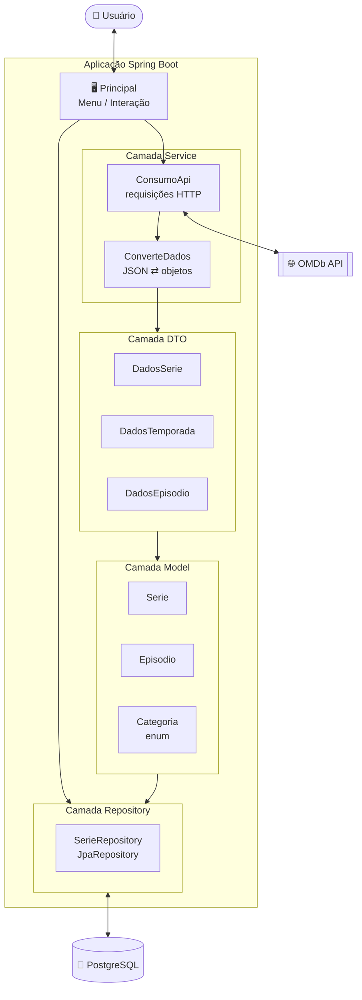
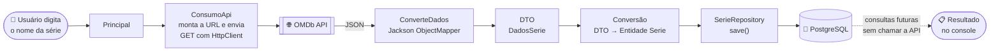
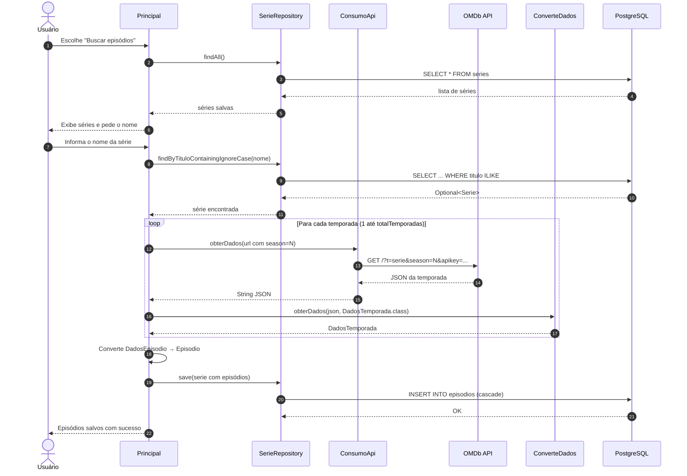
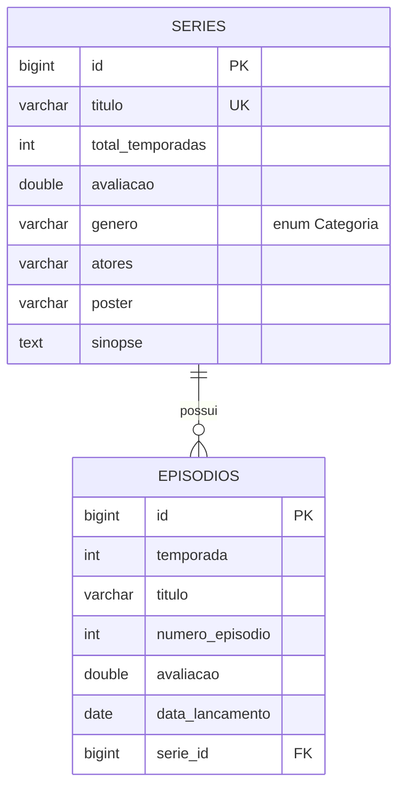

<div align="center">

# 🎬 ScreenMatch

**Aplicação Java com Spring Boot que consome a API OMDb, busca séries e episódios e persiste tudo em PostgreSQL para consultas futuras.**


</div>

---

## 📑 Sumário

- [Sobre o projeto](#-sobre-o-projeto)
- [Funcionalidades](#-funcionalidades)
- [Tecnologias e conceitos](#-tecnologias-e-conceitos)
- [Arquitetura em camadas](#-arquitetura-em-camadas)
- [Fluxo dos dados](#-fluxo-dos-dados)
- [Modelo de dados](#-modelo-de-dados)
- [Estrutura de pastas](#-estrutura-de-pastas)
- [Destaques técnicos](#-destaques-técnicos)
- [Como executar](#-como-executar)
- [Exemplo de uso](#-exemplo-de-uso)
- [Aprendizados](#-aprendizados)
- [Próximos passos](#-próximos-passos)
- [Autor](#-autor)

---

## 📖 Sobre o projeto

O **ScreenMatch** nasceu como projeto prático da formação **Java Back End da [Alura](https://www.alura.com.br/)**. A aplicação funciona como um catálogo pessoal de séries: o usuário informa o nome de uma série, o sistema consulta a **[OMDb API](https://www.omdbapi.com/)** via HTTP, converte o JSON recebido em objetos Java e **salva os dados no PostgreSQL**. Depois disso, é possível consultar tudo localmente, sem precisar chamar a API novamente.

O objetivo foi ir além do básico e praticar, em um único projeto:

- consumo de API externa e tratamento de respostas JSON;
- mapeamento objeto-relacional com **JPA/Hibernate**;
- consultas com **derived queries**, **JPQL** e **SQL**;
- organização do código em **camadas** (`model`, `repository`, `service`, `dto`);
- gerenciamento de dependências com **Maven**;
- configuração segura de credenciais por **variáveis de ambiente**.

---

## ✨ Funcionalidades

| # | Funcionalidade | Descrição |
|---|----------------|-----------|
| 1 | **Buscar série** | Consulta a OMDb API pelo título e salva a série no banco |
| 2 | **Buscar episódios** | Busca todas as temporadas de uma série já salva e persiste os episódios |
| 3 | **Listar séries buscadas** | Exibe todas as séries do banco, ordenadas por gênero |
| 4 | **Buscar série por título** | Pesquisa no banco por trecho do nome |
| 5 | **Buscar séries por ator** | Filtra por ator e avaliação mínima |
| 6 | **Top 5 séries** | Séries com melhor avaliação |
| 7 | **Buscar séries por categoria** | Filtra por gênero (ação, drama, comédia...) |
| 8 | **Filtrar por temporadas e avaliação** | Combina número máximo de temporadas e nota mínima |
| 9 | **Buscar episódio por trecho** | Pesquisa episódios pelo nome |
| 10 | **Top 5 episódios por série** | Melhores episódios de uma série específica |
| 11 | **Episódios a partir de uma data** | Filtra episódios por ano de lançamento |

> 💡 A primeira consulta de uma série vai à API; as seguintes usam apenas o banco de dados.

---

## 🛠 Tecnologias e conceitos

| Categoria | Tecnologia / Conceito |
|-----------|----------------------|
| **Linguagem** | Java 17+ |
| **Framework** | Spring Framework, Spring Boot |
| **Persistência** | Spring Data JPA, Hibernate |
| **Banco de dados** | PostgreSQL |
| **Build e dependências** | Maven |
| **Integração externa** | OMDb API (HTTP) com `HttpClient` |
| **Serialização JSON** | Jackson (`ObjectMapper`) |
| **Padrões** | Arquitetura em camadas, DTO, Repository, Injeção de Dependência |
| **Consultas** | Derived Queries, JPQL, SQL |
| **Boas práticas** | Variáveis de ambiente, Streams e Optional, Enum para categorias |

---

## 🏗 Arquitetura em camadas

O projeto separa responsabilidades em camadas bem definidas, facilitando manutenção, testes e evolução.



### Responsabilidade de cada camada

| Camada | Responsabilidade |
|--------|------------------|
| **`principal`** | Interação com o usuário (menu no console) e orquestração das operações |
| **`service`** | Regras de integração: faz a requisição HTTP e converte o JSON em objetos |
| **`dto`** | *Records* imutáveis que representam exatamente o formato da resposta da API |
| **`model`** | Entidades JPA que representam as tabelas do banco e carregam regras de negócio |
| **`repository`** | Interfaces Spring Data JPA com as consultas ao banco |

> **Por que separar DTO e Model?** O DTO espelha o contrato da API externa (que pode mudar ou trazer dados `"N/A"`). A entidade representa o que o *meu* sistema armazena. Essa separação isola o domínio de mudanças externas e permite tratar e converter os dados antes de persistir.

---

## 🔄 Fluxo dos dados

### Visão geral: da busca até a consulta futura



### Sequência detalhada: busca de episódios



---

## 🗄 Modelo de dados

Relacionamento **1:N** entre `Serie` e `Episodio`, mapeado com `@OneToMany` / `@ManyToOne` e persistência em cascata.



---

## 📂 Estrutura de pastas

> Ajuste o nome do pacote conforme o seu projeto.

```
screenmatch/
├── pom.xml
├── README.md
└── src/
    ├── main/
    │   ├── java/br/com/alura/screenmatch/
    │   │   ├── ScreenmatchApplication.java   # Ponto de entrada (CommandLineRunner)
    │   │   ├── principal/
    │   │   │   └── Principal.java            # Menu e fluxo de interação
    │   │   ├── service/
    │   │   │   ├── ConsumoApi.java           # Requisições HTTP
    │   │   │   ├── ConverteDados.java        # Desserialização JSON
    │   │   │   └── IConverteDados.java       # Contrato (interface)
    │   │   ├── dto/
    │   │   │   ├── DadosSerie.java
    │   │   │   ├── DadosTemporada.java
    │   │   │   └── DadosEpisodio.java
    │   │   ├── model/
    │   │   │   ├── Serie.java                # @Entity
    │   │   │   ├── Episodio.java             # @Entity
    │   │   │   └── Categoria.java            # enum
    │   │   └── repository/
    │   │       └── SerieRepository.java      # JpaRepository
    │   └── resources/
    │       └── application.properties
    └── test/
```

---

## 🔍 Destaques técnicos

### 1. Consumo da API com `HttpClient`

```java
public String obterDados(String endereco) {
    HttpClient client = HttpClient.newHttpClient();
    HttpRequest request = HttpRequest.newBuilder()
            .uri(URI.create(endereco))
            .build();

    try {
        HttpResponse<String> response =
                client.send(request, HttpResponse.BodyHandlers.ofString());
        return response.body();
    } catch (IOException | InterruptedException e) {
        throw new RuntimeException("Erro ao consultar a API", e);
    }
}
```

### 2. DTOs imutáveis com `record` e Jackson

Os *records* mapeiam o JSON da API, ignorando campos que o sistema não usa e traduzindo nomes via `@JsonAlias`.

```java
@JsonIgnoreProperties(ignoreUnknown = true)
public record DadosSerie(
        @JsonAlias("Title") String titulo,
        @JsonAlias("totalSeasons") Integer totalTemporadas,
        @JsonAlias("imdbRating") String avaliacao,
        @JsonAlias("Genre") String genero,
        @JsonAlias("Actors") String atores,
        @JsonAlias("Poster") String poster,
        @JsonAlias("Plot") String sinopse) {
}
```

### 3. Entidade JPA com relacionamento

```java
@Entity
@Table(name = "series")
public class Serie {

    @Id
    @GeneratedValue(strategy = GenerationType.IDENTITY)
    private Long id;

    @Column(unique = true)
    private String titulo;

    private Integer totalTemporadas;
    private Double avaliacao;

    @Enumerated(EnumType.STRING)
    private Categoria genero;

    private String atores;
    private String poster;
    private String sinopse;

    @OneToMany(mappedBy = "serie", cascade = CascadeType.ALL, fetch = FetchType.EAGER)
    private List<Episodio> episodios = new ArrayList<>();

    // construtores, getters e setters
}
```

### 4. Enum de categorias com tradução

O gênero retornado pela API (em inglês) é convertido para uma categoria própria do sistema.

```java
public enum Categoria {
    ACAO("Action"),
    ROMANCE("Romance"),
    COMEDIA("Comedy"),
    DRAMA("Drama"),
    CRIME("Crime");

    private final String categoriaOmdb;

    Categoria(String categoriaOmdb) {
        this.categoriaOmdb = categoriaOmdb;
    }

    public static Categoria fromString(String texto) {
        for (Categoria categoria : Categoria.values()) {
            if (categoria.categoriaOmdb.equalsIgnoreCase(texto)) {
                return categoria;
            }
        }
        throw new IllegalArgumentException("Nenhuma categoria encontrada: " + texto);
    }
}
```

### 5. Repository com Derived Queries e JPQL

```java
public interface SerieRepository extends JpaRepository<Serie, Long> {

    // Derived Query: o Spring gera o SQL a partir do nome do método
    Optional<Serie> findByTituloContainingIgnoreCase(String nomeSerie);

    List<Serie> findByAtoresContainingIgnoreCaseAndAvaliacaoGreaterThanEqual(
            String nomeAtor, Double avaliacao);

    List<Serie> findTop5ByOrderByAvaliacaoDesc();

    List<Serie> findByGenero(Categoria categoria);

    // JPQL: consulta orientada a objetos
    @Query("SELECT s FROM Serie s WHERE s.totalTemporadas <= :totalTemporadas "
         + "AND s.avaliacao >= :avaliacao")
    List<Serie> seriesPorTemporadaEAvaliacao(int totalTemporadas, double avaliacao);

    @Query("SELECT e FROM Serie s JOIN s.episodios e WHERE e.titulo ILIKE %:trechoEpisodio%")
    List<Episodio> episodiosPorTrecho(String trechoEpisodio);

    @Query("SELECT e FROM Serie s JOIN s.episodios e WHERE s = :serie "
         + "ORDER BY e.avaliacao DESC LIMIT 5")
    List<Episodio> topEpisodiosPorSerie(Serie serie);
}
```

### 6. Tratamento de dados inconsistentes

A OMDb pode retornar `"N/A"` em campos numéricos ou de data. O construtor da entidade trata esses casos para evitar falhas na conversão:

```java
this.avaliacao = OptionalDouble.of(Double.parseDouble(dados.avaliacao()))
                               .orElse(0.0);
```

> Também há tratamento de `NumberFormatException` e `DateTimeParseException` nos episódios.

---

## 🚀 Como executar

### Pré-requisitos

- [JDK 17+](https://adoptium.net/)
- [Maven 3.9+](https://maven.apache.org/) (ou use o `mvnw` incluso no projeto)
- [PostgreSQL](https://www.postgresql.org/download/) instalado e em execução
- Uma chave gratuita da [OMDb API](https://www.omdbapi.com/apikey.aspx)

### Passo a passo

**1. Clone o repositório**

```bash
git clone https://github.com/SEU_USUARIO/ScreenMatch.git
cd ScreenMatch
```

**2. Crie o banco de dados**

```sql
CREATE DATABASE screenmatch;
```

**3. Configure as variáveis de ambiente**

As credenciais **não ficam no código**. Defina as variáveis abaixo:

| Variável | Descrição | Exemplo |
|----------|-----------|---------|
| `DB_HOST` | Host e porta do PostgreSQL | `localhost:5432` |
| `DB_NAME` | Nome do banco | `screenmatch` |
| `DB_USER` | Usuário do banco | `postgres` |
| `DB_PASSWORD` | Senha do banco | `sua_senha` |
| `OMDB_API_KEY` | Chave da OMDb API | `abc12345` |

<details>
<summary><b>🐧 Linux / macOS</b></summary>

```bash
export DB_HOST=localhost:5432
export DB_NAME=screenmatch
export DB_USER=postgres
export DB_PASSWORD=sua_senha
export OMDB_API_KEY=sua_chave
```
</details>

<details>
<summary><b>🪟 Windows (PowerShell)</b></summary>

```powershell
$env:DB_HOST="localhost:5432"
$env:DB_NAME="screenmatch"
$env:DB_USER="postgres"
$env:DB_PASSWORD="sua_senha"
$env:OMDB_API_KEY="sua_chave"
```
</details>

**4. Confira o `application.properties`**

```properties
spring.datasource.url=jdbc:postgresql://${DB_HOST}/${DB_NAME}
spring.datasource.username=${DB_USER}
spring.datasource.password=${DB_PASSWORD}
spring.datasource.driver-class-name=org.postgresql.Driver

spring.jpa.hibernate.ddl-auto=update
spring.jpa.show-sql=false
spring.jpa.properties.hibernate.format_sql=true
```

> O `ddl-auto=update` cria e atualiza as tabelas automaticamente. Para produção, o ideal é usar migrations (ex.: Flyway).

**5. Execute a aplicação**

```bash
./mvnw spring-boot:run
```

Ou, com Maven instalado:

```bash
mvn spring-boot:run
```

---

## 💻 Exemplo de uso

```text
Escolha uma opção:
1 - Buscar séries
2 - Buscar episódios
3 - Listar séries buscadas
4 - Buscar série por título
5 - Buscar séries por ator
6 - Top 5 séries
7 - Buscar séries por categoria
8 - Filtrar séries por temporadas e avaliação
9 - Buscar episódio por trecho
10 - Top 5 episódios por série
11 - Buscar episódios a partir de uma data
0 - Sair

> 1
Digite o nome da série para busca:
> Gilmore Girls

Série salva com sucesso:
Serie{genero=COMEDIA, titulo='Gilmore Girls', totalTemporadas=7, avaliacao=8.2, ...}
```

### Exemplo da requisição feita à OMDb API

```http
GET https://www.omdbapi.com/?t=gilmore+girls&apikey=SUA_CHAVE
GET https://www.omdbapi.com/?t=gilmore+girls&season=1&apikey=SUA_CHAVE
```

---

## 🎓 Aprendizados

Principais conhecimentos praticados durante o desenvolvimento:

- **Spring Boot**: criação de projeto, `CommandLineRunner`, injeção de dependências e `application.properties`.
- **Maven**: estrutura do `pom.xml`, gerenciamento de dependências e *starters* do Spring.
- **Requisições HTTP em Java**: `HttpClient`, `HttpRequest`, `HttpResponse` e tratamento de exceções.
- **Jackson**: desserialização de JSON, `@JsonAlias`, `@JsonIgnoreProperties`.
- **JPA/Hibernate**: `@Entity`, `@Id`, `@Enumerated`, relacionamentos `@OneToMany`/`@ManyToOne` e *cascade*.
- **Spring Data JPA**: `JpaRepository`, *derived queries*, JPQL com `@Query` e `Optional`.
- **PostgreSQL e SQL**: modelagem, chaves primárias e estrangeiras, `JOIN`, filtros e ordenação.
- **Java moderno**: `record`, Streams, `Optional`, `enum` com atributos e *method references*.
- **Arquitetura**: separação em camadas, uso de DTO e princípio de responsabilidade única.
- **Segurança básica**: credenciais fora do código via variáveis de ambiente.

---

## 🧭 Próximos passos

- [ ] Expor os dados via **API REST** com `@RestController`
- [ ] Criar front-end consumindo a API
- [ ] Adicionar **testes unitários** (JUnit 5 + Mockito) e de integração
- [ ] Implementar **migrations** com Flyway
- [ ] Subir banco e aplicação com **Docker Compose**
- [ ] Documentar endpoints com **Swagger / OpenAPI**
- [ ] Criar camada de tratamento global de exceções
- [ ] Configurar **CI/CD** com GitHub Actions

---

## 👨‍💻 Autor

**SEU NOME**

[](https://www.linkedin.com/in/SEU_PERFIL)
[](https://github.com/SEU_USUARIO)
[](mailto:seu@email.com)

---

<div align="center">

Projeto desenvolvido durante a formação **Java Back End** da **[Alura](https://www.alura.com.br/)** 💙

⭐ Se este projeto te ajudou ou chamou sua atenção, deixe uma estrela no repositório!

</div>
